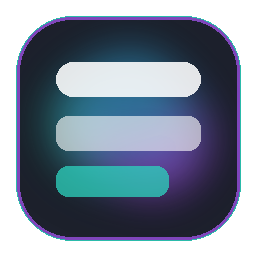
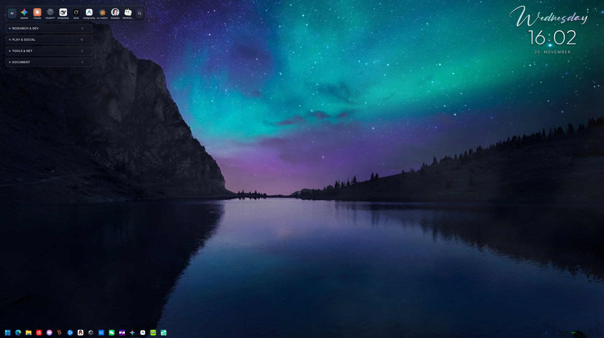
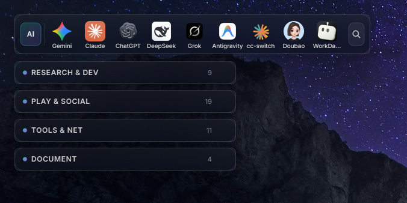
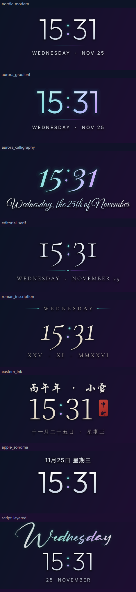
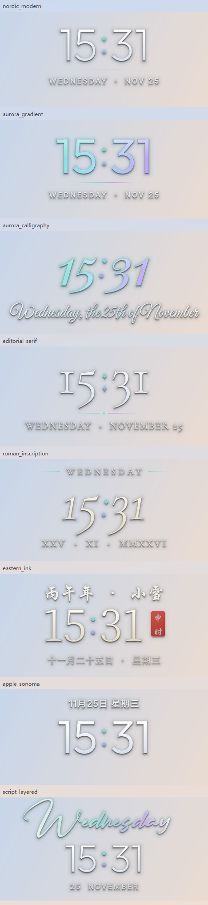

<div align="center">



# Aurora Desktop

**A Windows 11 desktop aesthetics suite: frosted-glass organizer · global search · artistic clock · fully transparent taskbar**

[](https://www.microsoft.com/windows)
[](https://github.com/ciinob/AuroraDesktop/releases)
[](https://github.com/ciinob/AuroraDesktop)

**[中文文档](README.md)** | English

Single-file, portable, auto-starts with Windows. Double-click `AuroraDesktop.exe` and your desktop is instantly reborn.

</div>

---

## ✨ What is it

Aurora Desktop is a desktop enhancement suite crafted for dark wallpapers: it sweeps your cluttered desktop icons into **frosted-glass capsule cards**, launches anything in milliseconds with a **Spotlight-style global search**, pins a **haute-couture artistic clock** to your desktop, and gives you a **truly transparent taskbar** that lets the wallpaper shine through.

No bloated framework, no heavyweight background service — one exe does it all.

## 📸 Screenshots






## 🚀 Four Core Powers

### 🔍 Aurora Spotlight (Global Search)
From anywhere, **double-tap `Ctrl`** (or press `Alt + S`) to summon it instantly:


- **Pinyin-initial fuzzy matching**: type `wx` for WeChat, `wyy` for NetEase Cloud Music, `vsc` for VS Code
- **Full coverage**: apps / PDFs / images / folders inside your capsules, plus everything in the Start Menu
- **Instant calculator**: `128 * 4.5`, `sqrt(2)`, `sin(pi/4)` — press Enter to copy the result
- **System commands**: type `lock` to lock the screen, `ip` to copy your IPv4, or hit Enter on any query to search the web

| Key | Action |
| --- | --- |
| `↑` / `↓` | Select result |
| `Enter` | Open |
| `Ctrl + Enter` | Run as administrator |
| `Alt + Enter` | Open file location |
| `Esc` | Close |

### 🧊 Frosted Capsule Organizer
- Desktop icons are auto-grouped into frosted-glass cards (**AI / Dev / Play / Tools / Documents**), with auto roll-up and magnetic alignment
- **Drag to reorder icons freely**, or drag them straight across capsules
- **VisionOS-style cursor-tracking border**: a 1px aurora highlight refracts along your cursor, and each icon glows with its own brand color (Claude coral, VS Code ice blue, WeChat jade…)
- 4 aurora color temperatures × 3 glass opacity levels — one click away in the tray menu

### 🕒 Haute-Couture Desktop Clock
8 hand-tuned typographic styles. Colons and hairlines follow the active aurora theme; ticking is aligned to second/minute boundaries (one repaint per minute when seconds are hidden — zero idle cost):

| Style | Typeface |
| --- | --- |
| ✨ Nordic Modern | Outfit ExtraLight |
| 🌈 Aurora Gradient | Outfit Light (theme gradient fill) |
| 🌌 Aurora Calligraphy | Playfair Display Italic × Great Vibes |
| 🏛️ Editorial Serif | Cormorant Garamond |
| 🕰️ Roman Inscription | Cormorant Italic · Roman numerals |
| 🖌️ Eastern Ink | STXingkai · sexagenary year, solar terms & vermilion seal |
| 🍎 macOS Sonoma | Outfit Light |
| ✍️ Script Layered | Ruthligos |

All 8 styles on a dark wallpaper:



Still perfectly legible on bright wallpapers (multi-layer soft halo):



### 🪟 Truly Transparent Taskbar
A custom C++ native engine (`AuroraTaskbarTAP.dll`, combining XAML `BackgroundFill` with Win32 `ACCENT_ENABLE_TRANSPARENTGRADIENT`) makes the taskbar genuinely disappear — wallpaper runs from the top of the screen to the very bottom. No more TranslucentTB black-bar conflicts.

## 📦 Install

1. Grab `AuroraDesktop.exe` from [**Releases**](https://github.com/ciinob/AuroraDesktop/releases)
2. Double-click to run — that's it. Single-file portable build; auto-start is registered on first launch
3. Right-click the tray icon to switch theme temperature / glass opacity / clock style / quick memo

> Requirement: Windows 11 (verified on 24H2)
>
> Portable builds keep `config.json`, `Groups/` and `memo.txt` next to the exe; if installed in a read-only directory (e.g. Program Files), data moves to `%APPDATA%\AuroraDesktop`. Use the tray menu "🔄 Check for updates" to see new releases.

## 🛠️ Run from Source

```bash
pip install -r requirements.txt   # PySide6 / pywin32
python src/main.py                # dev_run.bat for one-click debugging
rebuild_exe.bat                   # PyInstaller build + hot-swap the running exe
```

## 🧱 Tech Stack

- **UI**: Python 3.13 + PySide6 (custom frosted glass, QPainterPath text halos, high-refresh animations)
- **Native layer**: C++ XAML taskbar engine + Win32 API (desktop pinning, click-through, global hotkeys); rebuild the DLL from source via `src/native/CMakeLists.txt`
- **Typography**: Outfit / Cormorant Garamond / Playfair Display / Great Vibes / Ruthligos / STXingkai — all bundled
- **CI**: GitHub Actions builds the exe and publishes a Release with a SHA256 checksum on every version tag

## 📄 License

Application source is [MIT](LICENSE); bundled fonts keep their own licenses — see [THIRD_PARTY_NOTICES.md](THIRD_PARTY_NOTICES.md).

---

<div align="center">
If it makes your desktop a little prettier, a ⭐ Star means a lot
</div>
