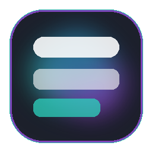
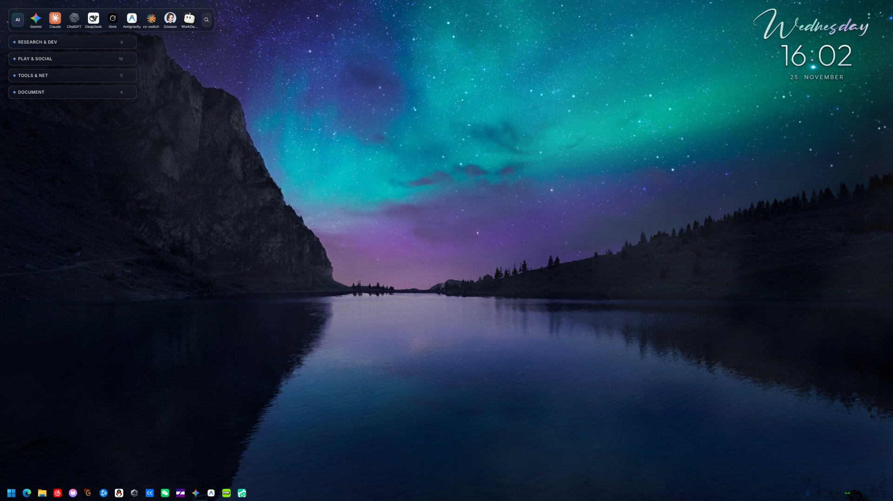
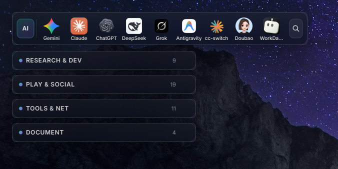
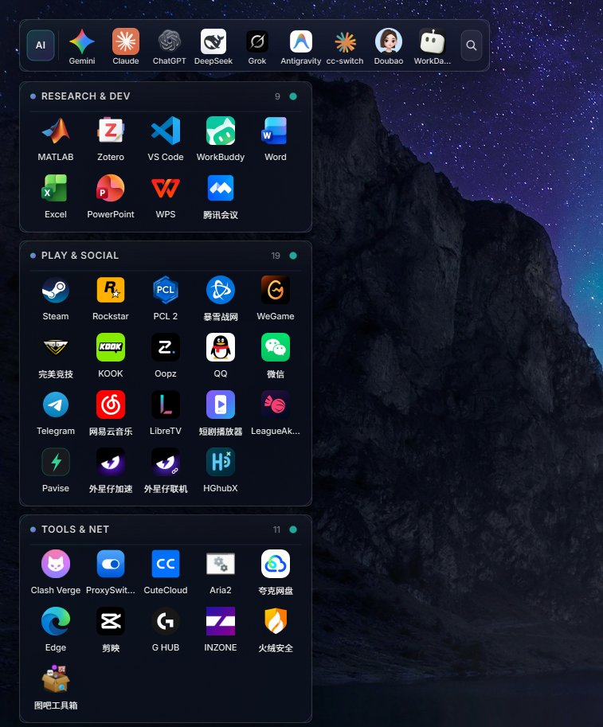
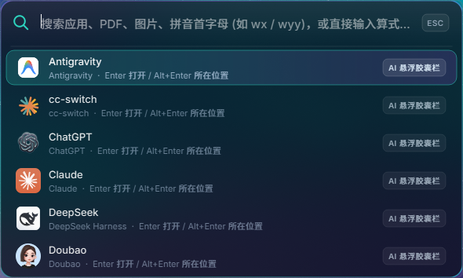
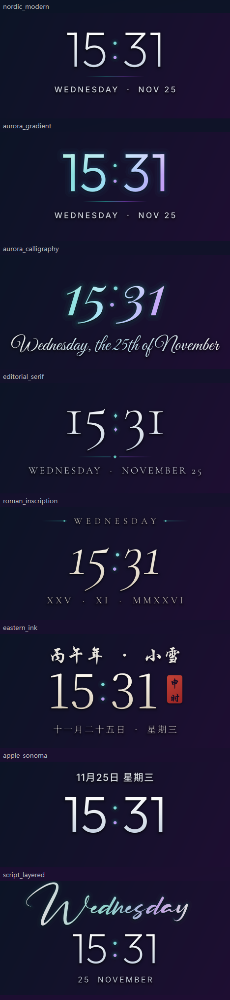
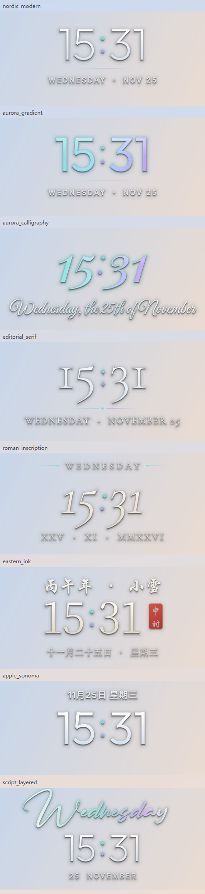

<div align="center">



# Aurora Desktop · 极光桌面

**Windows 11 桌面美学套件：毛玻璃收纳 · 全局搜索 · 艺术时钟 · 全透明任务栏**

[](https://www.microsoft.com/windows)
[](https://github.com/ciinob/AuroraDesktop/releases)
[](https://github.com/ciinob/AuroraDesktop)

中文 | **[English](README.en.md)**

单文件、免安装、开机自启。双击 `AuroraDesktop.exe`，桌面即刻焕然一新。

</div>

---

## ✨ 它是什么

Aurora Desktop 是一套专为深色壁纸深度定制的桌面增强套件：把你凌乱的桌面图标收进一排**极光毛玻璃胶囊卡片**，用 **Spotlight 式全局搜索**秒开任何应用，右上角挂一枚**高定艺术时钟**，再配一条**真正全透明、能看见壁纸的任务栏**。

没有臃肿的框架，没有后台驻留的累赘——一个 exe，全部搞定。

## 📸 效果图







## 🚀 四大核心能力

### 🔍 极光全局搜索（Aurora Spotlight）
任何界面下，**连按两下 `Ctrl`**（或 `Alt + S`）秒级唤出：



- **拼音首字母模糊匹配**：输入 `wx` 秒出微信、`wyy` 出网易云、`vsc` 出 VS Code
- **全覆盖检索**：胶囊内的应用 / PDF / 图片 / 文件夹 + 开始菜单全部已安装应用
- **即时计算器**：`128 * 4.5`、`sqrt(2)`、`sin(pi/4)`，回车直接复制结果
- **系统指令**：输入 `lock` 锁屏、`ip` 查本机 IP，任意词条回车直达网页搜索

| 按键 | 作用 |
| --- | --- |
| `↑` / `↓` | 选择结果 |
| `Enter` | 打开 |
| `Ctrl + Enter` | 以管理员身份运行 |
| `Alt + Enter` | 打开文件所在位置 |
| `Esc` | 关闭 |

### 🧊 极光胶囊收纳
- 桌面图标按 **AI 工具 / 研发 / 娱乐 / 网络工具 / 文档** 自动分组进毛玻璃卡片，自动卷起、磁吸对齐
- **图标自由拖拽排序**，跨胶囊直接拖放搬家
- **VisionOS 鼠标追光描边**：1px 极光边框随光标折射高光，图标主题色自适应光晕（Claude 珊瑚橙、VS Code 冰晶蓝、微信翡翠绿……）
- 4 套极光色温 × 3 档玻璃通透度，托盘右键一键切换

### 🕒 高定艺术桌面时钟
8 种手工调校的字体风格，冒号与饰线实时跟随主题色温，秒/分钟边界精准对齐刷新（不显示秒时每分钟仅重绘一次，零负担）：

| 风格 | 字体 |
| --- | --- |
| ✨ 极光纤雅几何风 | Outfit ExtraLight |
| 🌈 极光渐变大字风 | Outfit Light（主题流光渐变） |
| 🌌 极光流光花体风 | Playfair Display Italic × Great Vibes |
| 🏛️ 高定古典衬线风 | Cormorant Garamond |
| 🕰️ 罗马铭文古典风 | Cormorant Italic · 罗马纪年 |
| 🖌️ 东方书韵行楷风 | 华文行楷 · 干支节气 · 时辰印章 |
| 🍎 macOS 锁屏中文风 | Outfit Light |
| ✍️ 手写艺术分层风 | Ruthligos |

深色壁纸上的 8 种风格：



浅色壁纸上依旧清晰（多层柔和暗影光晕）：



### 🪟 全透明任务栏引擎
自绘 C++ 原生引擎（`AuroraTaskbarTAP.dll`，XAML `BackgroundFill` + Win32 `ACCENT_ENABLE_TRANSPARENTGRADIENT` 双管齐下），任务栏真正"消失"，壁纸从屏幕顶部贯穿到底部——彻底告别 TranslucentTB 的黑边冲突。

## 📦 安装与使用

1. 前往 [**Releases**](https://github.com/ciinob/AuroraDesktop/releases) 下载 `AuroraDesktop.exe`
2. 双击运行，搞定。单文件免安装，首次启动自动登记开机自启
3. 右键托盘图标：切换主题色温 / 玻璃通透度 / 时钟风格 / 速记便签

> 系统要求：Windows 11（24H2 已验证）
>
> 便携版将 `config.json`、`Groups/`、`memo.txt` 放在 exe 同目录；装在只读目录（如 Program Files）时自动改用 `%APPDATA%\AuroraDesktop`。托盘菜单「🔄 检查更新」可一键查看新版本。

## 🛠️ 从源码运行

```bash
pip install -r requirements.txt   # PySide6 / pywin32
python src/main.py                # dev_run.bat 一键调试
rebuild_exe.bat                   # PyInstaller 打包并热替换运行中的 exe
```

## 🧱 技术栈

- **UI 层**：Python 3.13 + PySide6（自绘毛玻璃、QPainterPath 文字光晕、高刷新动画）
- **原生层**：C++ XAML 任务栏引擎 + Win32 API（置底、点击穿透、全局热键），`src/native/CMakeLists.txt` 可从源码重建 DLL
- **字体排版**：Outfit / Cormorant Garamond / Playfair Display / Great Vibes / Ruthligos / 华文行楷，全部随包内置
- **持续集成**：GitHub Actions 自动打包并随 tag 发布 Release（附 SHA256 校验）

## 📄 许可

程序源码 [MIT](LICENSE)；内置字体各自遵循其许可，见 [THIRD_PARTY_NOTICES.md](THIRD_PARTY_NOTICES.md)。

---

<div align="center">
如果它让你的桌面好看了一点，欢迎点个 ⭐ Star
</div>
